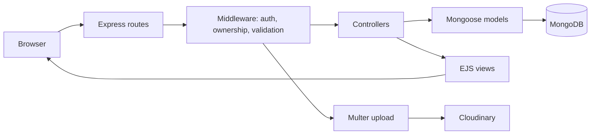
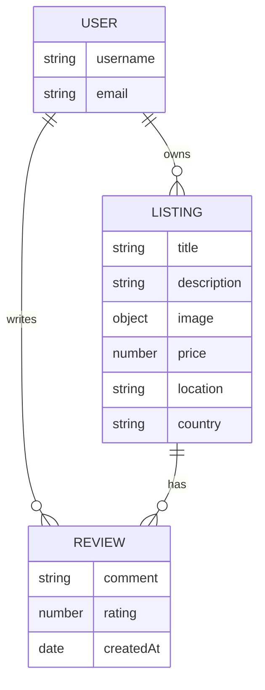

# WanderHome


A full-stack property listing web application where users can publish homes for travelers, browse listings, and share reviews. WanderHome is built with Node.js, Express, MongoDB, and server-rendered EJS templates, following the Model-View-Controller pattern.

## Overview

WanderHome lets registered users create and manage property listings with uploaded images, and leave star-rated reviews on any listing. Sessions are stored in MongoDB, images are hosted on Cloudinary, and ownership checks ensure that only a listing's owner or a review's author can change that content.

## Key Features

- **Listings:** create, view, edit, and delete property listings
- **Image uploads:** listing images uploaded to Cloudinary through Multer
- **Authentication:** sign up, log in, and log out using Passport with a local strategy, with hashed password storage through `passport-local-mongoose`
- **Authorization:** route-level checks restricting listing changes to the owner and review deletion to the author
- **Reviews:** star ratings from 1 to 5 with comments, using the Starability rating styles
- **Cascading cleanup:** deleting a listing also removes its reviews
- **Persistent sessions:** encrypted session storage in MongoDB through `connect-mongo`
- **Validation:** server-side review validation with Joi and client-side form validation with Bootstrap
- **User feedback:** flash messages for successful actions and errors
- **Error handling:** central error middleware with a dedicated error page
- **Sample data:** a seed script with 29 sample listings

## Technology Stack

| Layer | Technology |
| --- | --- |
| Runtime | Node.js 20 (declared in `package.json`) |
| Web framework | Express 5 |
| Views | EJS with `ejs-mate` layouts |
| Styling | Bootstrap 5.3, Font Awesome, custom CSS, Starability |
| Database | MongoDB with Mongoose 8 |
| Authentication | Passport, `passport-local`, `passport-local-mongoose` |
| Sessions | `express-session`, `connect-mongo` |
| File uploads | Multer, `multer-storage-cloudinary`, Cloudinary |
| Validation | Joi |

## Architecture and Workflow

Requests pass through route-level middleware for authentication, authorization, and validation before reaching a controller, which works with the Mongoose models and renders an EJS view.



### Data Model



## Project Structure

```text
WanderHome/
├── controllers/        Request handlers for listings, reviews, and users
├── init/               Seed script and sample data
├── models/             Mongoose schemas
├── public/             Stylesheets, client-side script, and logo
├── routes/             Express routers
├── utils/              Async wrapper and custom error class
├── views/              EJS layouts, partials, and pages
├── app.js              Application entry point
├── cloudConfig.js      Cloudinary and upload storage configuration
├── middleware.js       Authentication, authorization, and validation middleware
├── schema.js           Joi validation schemas
└── package.json
```

## Installation and Setup

### Prerequisites

- Node.js 20
- A MongoDB database, either MongoDB Atlas or a local instance
- A Cloudinary account for image uploads

### Install

```bash
git clone https://github.com/Partha-Shankar/WanderHome.git
cd WanderHome
npm install
```

## Configuration

Create a `.env` file in the project root. This file is excluded from version control.

```ini
ATLAS_URL=your_mongodb_connection_string
SESSION_SECRET=your_session_secret
MONGO_SECRET_KEY=your_session_store_encryption_secret
CLOUD_NAME=your_cloudinary_cloud_name
CLOUD_API_KEY=your_cloudinary_api_key
CLOUD_API_SECRET_KEY=your_cloudinary_api_secret
```

| Variable | Purpose |
| --- | --- |
| `ATLAS_URL` | MongoDB connection string for application data and sessions |
| `SESSION_SECRET` | Signs the session cookie |
| `MONGO_SECRET_KEY` | Encrypts session data stored in MongoDB |
| `CLOUD_NAME` | Cloudinary cloud name |
| `CLOUD_API_KEY` | Cloudinary API key |
| `CLOUD_API_SECRET_KEY` | Cloudinary API secret |

When `NODE_ENV` is set to `production`, the application does not load `.env` and reads these values from the environment directly.

## Usage

Start the server:

```bash
node app.js
```

Then open `http://localhost:8080/listings`, which is the application's main page.

### Seeding Sample Data

```bash
node init/index.js
```

Before running the script, note the following:

- It connects to the local database `mongodb://127.0.0.1:27017/wanderLust`, not to `ATLAS_URL`. To use the seeded data in the application, set `ATLAS_URL` to the same database.
- It **deletes all existing listings** in that database before inserting the sample data.
- It assigns every listing the owner ID defined in `init/index.js`. Sign up first, then replace that value with the `_id` of a user in the same database so that listing detail pages can display the owner.
- The process keeps its database connection open, so press `Ctrl+C` after it reports that the data was initialized.

### Routes

| Method | Path | Access | Purpose |
| --- | --- | --- | --- |
| GET | `/listings` | Public | List all properties |
| GET | `/listings/new` | Logged in | New listing form |
| POST | `/listings` | Logged in | Create a listing |
| GET | `/listings/:id` | Public | Listing details and reviews |
| GET | `/listings/:id/edit` | Owner | Edit listing form |
| PUT | `/listings/:id` | Owner | Update a listing |
| DELETE | `/listings/:id` | Owner | Delete a listing and its reviews |
| POST | `/listings/:id/reviews` | Logged in | Add a review |
| DELETE | `/listings/:id/reviews/:reviewId` | Author | Delete a review |
| GET, POST | `/signup` | Public | Registration form and handler |
| GET, POST | `/login` | Public | Login form and handler |
| GET | `/logout` | Public | End the session |

## Technical Implementation

### Request Handling

HTML forms send PUT and DELETE requests through `method-override`, using the `_method` query parameter. `utils/wrapAsync.js` forwards rejected promises to the error middleware, and `utils/expressError.js` carries an HTTP status code with each error.

### Authentication and Sessions

`passport-local-mongoose` adds username, password hashing, and authentication methods to the user model. Sessions use a 24-hour, HTTP-only cookie, and `connect-mongo` stores them in MongoDB with its `crypto` option enabled.

### Authorization

`middleware.js` provides `isLoggedIn`, `isOwner`, and `isReviewAuthor`. Each route composes the checks it needs, and the views show edit and delete controls only to the relevant user.

### Image Storage

`cloudConfig.js` configures `multer-storage-cloudinary` to place PNG, JPG, and JPEG uploads in a `wanderHome` Cloudinary folder. The resulting URL and filename are saved on the listing.

### Data Integrity

A Mongoose `findOneAndDelete` post hook on the listing schema removes all associated reviews. Deleting a single review uses `$pull` to remove its reference from the parent listing.

## Future Scope

- A landing page at the site root
- Search and filtering on the listings page
- A booking and availability workflow
- An automated test suite
